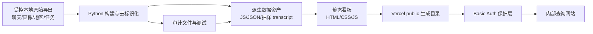

# 网站架构

## 数据流

## 分层职责

| 层 | 路径 | 职责 |
|-|-|-|
| 原始输入 | 本地 `outputs/` 等受控目录 | 保存查询导出；含直接身份字段时禁止入 Git |
| 构建层 | `dino-chat-dashboard/scripts/` | 去重、匿名索引、聚合、采样、翻译和审计 |
| 数据层 | `dino-chat-dashboard/*.js`、`analysis/` | 页面可直接读取的去标识化快照与证据 |
| 展示层 | `dino-chat-dashboard/index.html`、JS、CSS | 总览及 HOME / EXPLORE / POST_CLASS / Bad Case 页面 |
| 托管层 | `dino-chat-dashboard-vercel/` | 环境变量认证、安全响应头和 Vercel 配置 |
| 治理层 | `docs/dashboard/`、`data/manifests/`、测试 | 口径、追溯、隐私边界和回归保障 |

## 源码与部署副本

`dino-chat-dashboard/` 是唯一可编辑的网页源码。部署前运行 `scripts/sync-dashboard-deploy.sh`，把根目录的静态资产复制到被忽略的 `dino-chat-dashboard-vercel/public/`。不要直接编辑 `public/`，避免本地源码和线上副本漂移。

## 访问保护

`proxy.js` 从 `DASHBOARD_USERNAME` 和 `DASHBOARD_PASSWORD` 读取共享凭证，使用恒定时间比较，并返回 `no-store`、`nosniff`、`DENY`、`no-referrer` 等响应头。凭证只配置在托管环境，不出现在仓库。
